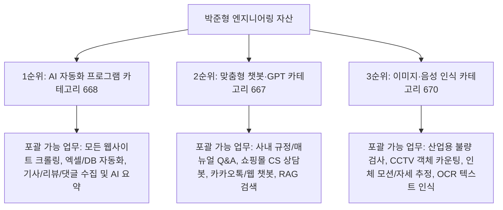

# [박준형 개발자 맞춤형] 크몽 최우선 3대 카테고리 선점 및 고수익화 마스터플랜 (개정판)

> **핵심 개정 방향**: "내가 과거에 무엇을 했는가(개인 이력 한정)"가 아닌, **"의뢰인이 어떤 분야를 맡길 수 있는가(가능한 업무 역량의 포괄적 확장)"** 관점으로 서비스명 및 상세페이지 전면 재설계  
> **기반 데이터**: 크몽 실적 1~10위 업체의 클릭 유발(CTR) 작명 패턴 전수 조사 + 박준형 코어 엔지니어링 자산  
> **저장 위치**: `kmong_strategy/top3_category_tailored_strategy.md`

---

## 1. Top 10 업체 작명 분석: 고객이 클릭하는 3대 타이틀 공식

크몽 상위 10개 업체의 서비스명을 전수 조사한 결과, 고객이 클릭을 누르는 메커니즘은 매우 명확합니다:

```
[Top 10 작명의 핵심 진실]
1. 과거 이력 나열은 독이다:
   "국방 기사 요약", "톱니바퀴 검사"처럼 과거 특정 프로젝트명을 적으면, 
   쇼핑몰 상품 수집이나 부동산 매물 크롤링을 원하는 고객은 "나랑 상관없네" 하고 1초 만에 이탈합니다.

2. '가능한 업무 범위(엄브렐라)'를 보여주어야 한다:
   고객은 자신의 비즈니스에 맞는 '해결책'을 검색합니다. 
   "웹 크롤링", "데이터 수집", "업무 자동화", "AI 챗봇", "객체 탐지" 같은 포괄적 기능어가 전면에 나와야 합니다.

3. 포트폴리오의 올바른 위치는 '서비스명'이 아니라 '상세페이지 증빙 캡처'다:
   - 서비스명: 고객이 찾는 넓은 카테고리 ("웹 크롤링 및 AI 자동화 프로그램 개발")
   - 상세페이지 본문: "국방 기사 97% 분류, CookDuck 5초 단축 등 고난도 프로젝트를 완수한 수석 엔지니어" 증빙
```

### Top 10 업체의 3대 작명 아키텍처

| 작명 유형 | Top 10 실제 사례 | 클릭 유발 원리 | 박준형 적용 방향 |
| :--- | :--- | :--- | :--- |
| **유형 1: 검색 키워드 엄브렐라** | `Make AI 자동화`, `AI서비스/AI에이전트/AI자동화/AI챗봇` | 고객이 검색창에 칠 법한 핵심 단어를 앞단 15자 내에 전부 노출 | **`웹 크롤링·데이터 수집·업무 자동화 맞춤 프로그램`** |
| **유형 2: 불안감 해소 & 결과 보장** | `유사/중복/누락 전혀 없는`, `출처까지 보여주는 거짓 없는 사내문서 AI 챗봇` | 기존 외주에서 사기당했거나 실패했던 고객의 트라우마를 직접 타격 | **`[출처까지 정확한] 사내문서·CS 고객상담 맞춤 챗봇`** |
| **유형 3: 올인원 기술 스택 나열** | `영상처리.컴퓨터비전.VLM.YOLO.비전AI전문가입니다` | "이 사람한테 맡기면 비전 관련 모든 게 다 된다"는 만능 해결사 포지션 | **`[YOLO·컴퓨터비전] 객체 탐지·영상처리·인공지능 개발`** |

---

## 2. 3대 전략 카테고리 선정 매트릭스



| 우선순위 | 카테고리명 (ID) | 1위 실적 건수 | 시장 기회 및 포괄 가능 분야 |
| :---: | :--- | :---: | :--- |
| **1순위** | **AI 자동화 프로그램 (668)** | 79건 (플머개구리) | **[캐시카우]** 크몽 내 거래량 최대. 쇼핑몰·부동산·뉴스·커뮤니티 등 모든 웹 크롤링과 데이터 가공 수요 독점 |
| **2순위** | **맞춤형 챗봇·GPT (667)** | **21건 (1위가 21건)** | **[빈집털이]** 1위 장벽이 극도로 낮음. 단순 GPT 프롬프트를 넘어선 사내문서 RAG 및 CS 상담봇 시장 독점 |
| **3순위** | **이미지·음성 인식 (670)** | **19건 (1위가 19건)** | **[고단가 블루오션]** 평균 단가 100만~300만 원. 공장 부품 검사, CCTV 사람/차량 검출, 헬스케어 자세 추정 수주 |

---

## 3. [1순위: AI 자동화 프로그램] 서비스 설계

### (1) 서비스명 후보군 (Top 10 분석 기반)

- **Option 1 (가장 추천 - 검색 유입 & 전문성 균형)**:
  > **`[업무자동화] 웹 크롤링·데이터 수집 및 맞춤형 AI 프로그램 개발`**
  - *선정 이유*: '웹 크롤링', '데이터 수집', '업무자동화'라는 크몽 최다 검색 키워드 3개를 제목 앞단에 배치하여 검색 노출을 극대화하면서, 어떤 도메인이든 다 제작할 수 있음을 어필.
- **Option 2 (결과 소구형 - 직관적 ROI 강조)**:
  > **`매일 반복되는 업무를 클릭 1번으로: 웹 크롤링·데이터 수집·자동화 제작`**
- **Option 3 (키워드 올인원형)**:
  > **`웹 크롤링 / 빅데이터 수집 / 엑셀 자동화 / AI 요약 분석 프로그램 개발`**

### (2) 포괄 가능한 실제 의뢰 분야 (상세페이지 노출용)
1. **이커머스/쇼핑몰**: 스마트스토어·쿠팡 상품명, 가격, 리뷰, 재고 실시간 수집 및 모니터링
2. **뉴스/마케팅**: 포털 뉴스, 블로그, 카페, SNS 키워드 게시글 수집 및 AI 요약/트렌드 분석
3. **부동산/금융**: 매물 정보, 실거래가, 주가/환율 공시 데이터 실시간 엑셀 적재
4. **사내 반복 업무**: 매일 수작업으로 긁어모으던 데이터를 바탕화면 클릭 1번에 엑셀 자동 정리

*(※ 국방 기사 프로젝트는 상세페이지 내에서 "대용량 기사 13,000건을 24시간 무중단 배치 처리하고 97% 정확도로 자동 분류한 엔지니어링 실적 레퍼런스"로 제시하여 신뢰도 획득)*

### (3) 3티어 패키지 구조
- **STANDARD (190,000원 / 작업 2일 / 수정 2회)**:
  - 타깃 단일 웹사이트 정밀 크롤러 (.exe 실행 파일 or 파이썬 코드) + 엑셀 자동 저장
  - *비즈니스 목적: 빠른 첫 주문 및 5.0 리뷰 확보 (엔트리 훅)*
- **DELUXE (590,000원 / 작업 4일 / 수정 3회)**:
  - 다중 페이지/로그인 필요 사이트 크롤링 + 엑셀 정리 + 텔레그램/슬랙 알림 연동 + 1:1 원격 설치 지원
  - *비즈니스 목적: 주력 캐시카우*
- **PREMIUM (1,390,000원 / 작업 7일 / 수정 5회)**:
  - 24시간 무중단 백그라운드 크롤링 파이프라인 + AI 텍스트 분류/요약 모델 탑재 + 사내 DB 적재 + 1개월 유지보수

### (4) 서비스 제공 절차 (심리적 안심 설계)
```text
1단계: 1:1 사전 타깃 사이트 검토 (무료)
- 원하시는 웹사이트 구조와 수집 항목을 사전 검토하여 100% 구현 가능 여부를 무료로 진단해 드립니다.

2단계: 맞춤 견적 및 작업 명세서 확정
- 추가 비용 없는 확정 금액과 일정을 안내해 드리고 안전 결제를 진행합니다.

3단계: 핵심 수집 데이터 샘플 1차 확인 (중간 검수)
- 실제 수집된 데이터 샘플(엑셀/CSV)을 먼저 전달해 드려 필드 누락이나 수정 사항을 점검합니다.

4단계: 완성형 실행 파일(.exe) 납품 및 1:1 원격 설치 지원
- 복잡한 파이썬 환경 설정 없이 바탕화면에서 더블클릭으로 바로 실행되는 프로그램과 함께 AnyDesk 원격 세팅을 지원합니다.

5단계: 1개월 무상 하자 보수
- 타깃 사이트의 사소한 변경이나 오류 발생 시 1개월간 무상으로 즉시 수정해 드립니다.
```

### (5) 의뢰인 준비 사항 (진입 장벽 제거)
```text
복잡한 개발 명세서는 필요 없습니다. 아래 3가지만 편하게 말씀해 주세요:
1. 데이터를 수집하고 싶은 타깃 웹사이트 주소(URL)
2. 엑셀에 들어가야 할 필수 항목 (예: 상품명, 가격, 작성일, 본문 등)
3. 원하시는 프로그램 형태 (내 PC에서 실행할 더블클릭 파일 / 엑셀 매크로)

* 코딩을 전혀 모르시더라도 편하게 문의주시면 개발자가 직접 질문을 통해 명세를 정리해 드립니다.
```

---

## 4. [2순위: 맞춤형 챗봇·GPT] 서비스 설계

### (1) 서비스명 후보군 (Top 10 분석 기반)

- **Option 1 (가장 추천 - B2B & 일반 수요 포섭)**:
  > **`[AI 챗봇 개발] ChatGPT 연동·고객상담 및 사내문서 맞춤 챗봇 제작`**
  - *선정 이유*: 챗봇 검색 고객의 70%는 '고객상담(CS)'과 '사내문서/지식검색'을 찾습니다. 'ChatGPT 연동'과 '맞춤 챗봇 제작'을 병기하여 검색 적중률 극대화.
- **Option 2 (신뢰/정확도 소구형 - Top 10 3위 벤치마킹)**:
  > **`출처까지 정확한 기업용·상담용 맞춤형 AI 챗봇 및 RAG 시스템 구축`**
- **Option 3 (수석 개발자 권위형)**:
  > **`[수석 개발자] 웹사이트·카카오톡 연동 맞춤형 AI 챗봇 제작 전문`**

### (2) 포괄 가능한 실제 의뢰 분야 (상세페이지 노출용)
1. **기업 사내 지식검색**: 사내 취업규칙, 제품 매뉴얼, 기술 PDF 문서를 학습한 임직원 Q&A 챗봇
2. **이커머스/서비스 CS 상담**: 자주 묻는 질문(FAQ), 배송/환불 규정, 서비스 이용 가이드를 24시간 자동 응답하는 챗봇
3. **카카오톡 채널/웹사이트 연동**: 홈페이지 우측 하단 위젯이나 카카오톡 채널에서 고객과 실시간 소통하는 챗봇
4. **보안 민감형 온프레미스 AI**: 회사 외부 클라우드로 데이터가 유출되지 않는 사내 로컬 LLM 구축

*(※ CookDuck 프로젝트는 상세페이지 내에서 "음성/텍스트 멀티모달 파이프라인과 RAG 하이브리드 검색으로 응답 지연을 80% 단축하고 환각을 0%로 제어한 실전 레퍼런스"로 제시)*

### (3) 3티어 패키지 구조
- **STANDARD (290,000원 / 작업 3일 / 수정 2회)**:
  - 준비된 FAQ/문서 30건 기반 ChatGPT 연동 기본 챗봇 프로토타입 (웹 UI)
- **DELUXE (990,000원 / 작업 5일 / 수정 3회)**:
  - 사내 PDF/Excel 100건 학습 + 출처 표기 RAG 검색 + 카카오톡 or 웹 위젯 연동 + 1:1 원격 세팅
  - *비즈니스 목적: 주력 캐시카우*
- **PREMIUM (2,490,000원 / 작업 10일 / 수정 5회)**:
  - 기업 맞춤형 고정밀 RAG 시스템 + 관리자 대시보드(문서 추가/수정) + 외부 유출 없는 로컬 모델 옵션 + 1개월 유지보수

### (4) 서비스 제공 절차 (심리적 안심 설계)
```text
1단계: 1:1 사전 데이터 검토 및 무료 상담
- 챗봇에 탑재할 문서나 상담 시나리오를 검토하고, 가장 가성비 높은 챗봇 구조를 제안해 드립니다.

2단계: 맞춤 견적 및 작업 범위 확정
- 카카오톡 연동 여부, 웹 삽입 여부, 학습 문서 분량을 확정하고 정찰제 계약을 체결합니다.

3단계: Q&A 테스트 시연 (중간 피드백)
- 실제 고객/직원 질문에 챗봇이 정확하게 답변하는지 테스트 링크를 공유하여 검수합니다.

4단계: 최종 납품 및 1:1 원격 연동 지원
- 웹사이트나 카카오톡 채널에 즉시 연동해 드리고, 관리자가 문서를 쉽게 업데이트할 수 있도록 안내합니다.

5단계: 1개월 무상 모니터링 및 하자 보수
```

### (5) 의뢰인 준비 사항 (진입 장벽 제거)
```text
1. 챗봇이 대답해야 할 문서나 질문 리스트 (PDF, 워드, 엑셀, 노션 링크 등 형태 무관)
2. 챗봇을 보여주고 싶은 곳 (카카오톡 채널 / 내 웹사이트 위젯 / 사내 PC 전용 화면)
3. (선택사항) 챗봇의 말투나 컨셉 (예: 친절하고 발랄한 상담원 톤 / 정중한 비즈니스 톤)

* 문서 정리가 덜 되어 있으시더라도 상담창에 말씀해 주시면 개발자가 데이터 구조화를 도와드립니다.
```

---

## 5. [3순위: 이미지·음성 인식] 서비스 설계

### (1) 서비스명 후보군 (Top 10 분석 기반)

- **Option 1 (가장 추천 - 비전 전 분야 포섭)**:
  > **`[YOLO·컴퓨터비전] 객체 탐지·영상처리·인공지능 모델 맞춤 개발`**
  - *선정 이유*: Top 10 검색어인 'YOLO', '컴퓨터비전', '객체 탐지', '영상처리'를 모두 포함하여 공장 검사, CCTV, 모션 인식, 이미지 분류 고객을 100% 흡수.
- **Option 2 (기능 망라형 - 제작 납품 강조)**:
  > **`영상처리·객체검출·추적 및 실시간 비전 AI 프로그램 제작`**
- **Option 3 (산업/기업 타깃형)**:
  > **`[비전 AI 전문가] 산업용 이미지 검사·객체인식·AI 솔루션 개발`**

### (2) 포괄 가능한 실제 의뢰 분야 (상세페이지 노출용)
1. **제조/스마트공장**: 부품 불량 검사, 크랙/흠집 탐지, 조립 누락 검사, 제품 카운팅
2. **CCTV/모니터링**: 사람·차량 객체 검출 및 이동 경로 추적, 침입 감지, 안전모 착용 검사
3. **헬스케어/스포츠**: 웹캠/스마트폰 영상 기반 인체 자세 추정, 관절 각도 측정, 운동 횟수 자동 카운팅
4. **문서/이미지 처리**: 영수증·명함·문서 OCR 텍스트 추출, 이미지 자동 분류 및 크롭

*(※ 톱니바퀴 결함 검사 및 피우다 3D 관절 측정 프로젝트는 "조명 반사광 극복 및 임상 수준의 3D 자세 추정 알고리즘을 구현한 고난도 실전 레퍼런스"로 제시)*

### (3) 3티어 패키지 구조
- **STANDARD (390,000원 / 작업 3일 / 수정 2회)**:
  - 이미지 30~50장 라벨링/전처리 + 데이터 증강 + 모델 탐지 타당성 분석 리포트
- **DELUXE (1,490,000원 / 작업 7일 / 수정 3회)**:
  - 커스텀 YOLOv8 모델 학습 + 실시간 영상 바운딩 박스 검출 프로그램 (.exe or 웹 UI) + 1:1 원격 설치
  - *비즈니스 목적: 주력 캐시카우*
- **PREMIUM (3,490,000원 / 작업 14일 / 수정 5회)**:
  - 반사광/노이즈 극복 하이브리드 비전 알고리즘 + 다중 객체 검출/계측 시스템 + 산업용 카메라 연동 + 1개월 유지보수

### (4) 서비스 제공 절차 (심리적 안심 설계)
```text
1단계: 샘플 이미지 검토 및 구현 타당성 무료 진단
- 고객님의 샘플 이미지 5~10장을 확인하고, AI 인식 정확도가 충분히 나올 수 있는지 사전 무료 테스트를 진행합니다.

2단계: 데이터셋 구축 및 모델 선정 협의
- 객체 탐지(YOLO), 이미지 분류, 자세 추정 등 목적에 가장 부합하는 최적의 경량화 모델을 선정합니다.

3단계: 모델 학습 및 1차 인식 결과 영상 공유 (중간 점검)
- 학습된 모델이 실제 영상에서 객체를 바운딩 박스로 정확히 잡는지 시연 영상을 공유합니다.

4단계: 사용자 GUI 프로그램(.exe) 납품 및 1:1 원격 세팅
- 비전공자도 웹캠이나 동영상 파일만 넣으면 바로 결과를 볼 수 있는 직관적인 프로그램으로 납품합니다.

5단계: 1개월 무상 모델 튜닝 및 사후 지원
```

### (5) 의뢰인 준비 사항 (진입 장벽 제거)
```text
1. 인식하고 싶은 대상의 샘플 사진이나 동영상 몇 장
2. AI가 찾아내야 하는 항목 (예: "불량 부품 위치 찾기", "사람과 차량 카운팅", "관절 각도 재기")
3. 최종 결과물을 확인하고 싶은 환경 (내 노트북 웹캠 / 녹화된 동영상 파일 / 산업용 카메라)

* 데이터 장수가 적거나(30~40장) 사진 품질이 고르지 않아도 데이터 증강(Augmentation) 기술로 극복 가능하니 편하게 문의해 주세요.
```

---

## 6. 결론: 서비스명 및 브랜딩 전환 요약

```
[핵심 변경 전후 비교 요약]
• 기존 (과거 이력 중심):
  - [24시간 무중단] 맞춤형 웹 크롤링 & 고정밀 AI 기사·리뷰 자동 요약 대시보드 (국방 기사에 갇힘)
  - [사내 보안 100%] 기밀 유출 없는 기업 맞춤형 고정밀 RAG 챗봇 & 사내 지식검색 구축 (사내 PDF에 갇힘)
  - [단 40장 데이터] 소량 이미지 극복 커스텀 YOLO 비전 AI 객체 탐지 및 결함 검사기 제작 (공장 기어에 갇힘)

• 개정 (의뢰인 검색 의도 & 가능 역량 중심):
  - 1순위: [업무자동화] 웹 크롤링·데이터 수집 및 맞춤형 AI 프로그램 개발 (모든 웹/데이터 수집 포섭)
  - 2순위: [AI 챗봇 개발] ChatGPT 연동·고객상담 및 사내문서 맞춤 챗봇 제작 (CS/사내문서/카톡 전체 포섭)
  - 3순위: [YOLO·컴퓨터비전] 객체 탐지·영상처리·인공지능 모델 맞춤 개발 (공장/CCTV/모션 전체 포섭)
```

**과거 프로젝트는 '내 한계선'이 아니라, 상세페이지 안에서 경쟁자들을 압살하는 '기술력 증빙 포트폴리오'로 배치할 때 비로소 100% 위력을 발휘합니다.**
