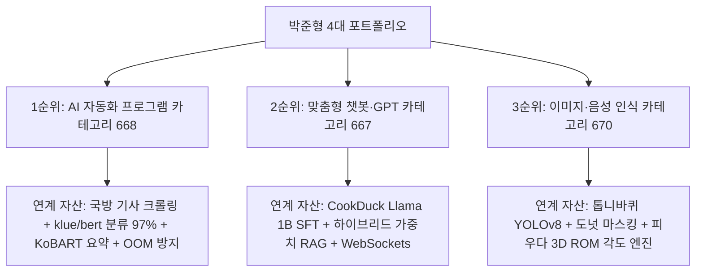

# [박준형 개발자 맞춤형] 크몽 최우선 3대 카테고리 선점 및 압도적 고수익화 전략

> **기반 분석**: 크몽 12개 AI 카테고리 실적 1~10위 전수 조사 데이터 (`top_10_successful_services_analysis.md`)  
> **개발자 코어 자산**: 인공지능소프트웨어학과 수석(4.44), 정보처리기사, CookDuck(RAG/경량화), 국방기사(크롤링/요약), 톱니바퀴(YOLO/비전), 피우다(3D ROM)  
> **목적**: 박준형 개발자의 포트폴리오에 가장 완벽하게 부합하는 3대 전략 카테고리를 선정하고, 상위 10위의 성공 공식을 흡수하여 90일 내 시장을 장악하는 마스터 실행 전략 수립  
> **저장 위치**: `kmong_strategy/top3_category_tailored_strategy.md`

---

## 1. 박준형 개발자에게 가장 적합한 최우선 3대 카테고리 선정 이유

크몽 12개 카테고리의 주문 볼륨, 경쟁 강도, 단가 수준, 포트폴리오 일치도를 종합 매트릭스로 분석한 결과, 아래 3개 카테고리가 가장 성공 확률과 마진이 높습니다.



### 3대 카테고리 선정 매트릭스

| 우선순위 | 카테고리명 (ID) | 시장 주문 볼륨 | 1위 실적 건수 | 매칭 포트폴리오 | 선정 이유 및 기회 요인 |
| :---: | :--- | :---: | :---: | :--- | :--- |
| **1순위** | **AI 자동화 프로그램 (668)** | **최상 (총 1,133건+)** | 79건 (플머개구리) | **국방 기사 자동 크롤링 & 분류·요약 파이프라인** | 크몽 AI 전 분야 중 현금이 가장 빠르게 도는 캐시카우. 단순 매크로를 넘어선 '고급 AI 요약/수집'으로 고단가 장악 가능. |
| **2순위** | **맞춤형 챗봇·GPT (667)** | **고성장 (빈집털이)** | **21건 (1위가 21건에 불과)** | **CookDuck 하이브리드 RAG & 경량 모델 파이프라인** | 1위가 고작 21건으로 1위 탈환 장벽이 극도로 낮음. 대다수 셀러가 단순 프롬프트 래핑 수준이라 '사내 보안 RAG'로 독점 가능. |
| **3순위** | **이미지·음성 인식 (670)** | **초고단가 블루오션** | **19건 (1위가 19건에 불과)** | **톱니바퀴 YOLOv8 하이브리드 검사 & 피우다 3D ROM** | 평균 객단가 50만~300만 원대의 고단가 시장. 경쟁자 기술 수준이 낮아 박준형의 비전/모션 엔지니어링으로 B2B 독점 수주 가능. |

---

## 2. 1순위: [AI 자동화 프로그램] 타깃 전략 & 상세페이지 구성안

### (1) 상위 1~10위 벤치마킹 핵심 인사이트
- **1위 플머개구리 (리뷰 79개, 시작가 34.9만 원)**: 1년 라이선스 패키징(Home 34.9만 / Pro 52.9만 / Ultra 69.9만 원)으로 높은 객단가 확보.
- **2위 지지파크 (리뷰 72개, 시작가 2만 원)**: 2만 원 저가 엔트리 오퍼로 폭발적 리뷰 축적.
- **3위 리부티너 (리뷰 70개, 시작가 20만 원)**: "마음에 부담을 내려놓으십시오. 다들 잘 모릅니다"라는 심리적 허들 제거 카피로 B2B 전환.

### (2) 박준형의 불공정 우위 (Unfair Advantage)
- 일반 셀러의 단순 셀레니움 매크로는 사이트가 개편되거나 대량 데이터 처리 시 OOM(메모리 터짐)으로 멈춥니다.
- 박준형은 **"50개 단위 배치 처리로 24시간 무중단 구동 + klue/bert 97% 고정밀 AI 분류 + KoBART 3줄 요약"**이라는 압도적 엔지니어링 신뢰도를 갖추고 있습니다.

### (3) 크몽 등록용 완성형 문안

#### 서비스명:
> `[24시간 무중단] 맞춤형 웹 크롤링 & 고정밀 AI 기사·리뷰 자동 요약 대시보드`

#### 패키지 가격 전략:
- **STANDARD (190,000원 / 작업 2일 / 수정 2회)**:
  - 타깃 단일 웹사이트 정밀 크롤러 (.exe 로컬 실행 파일) + 엑셀 자동 저장
  - *비즈니스 목적: 빠른 첫 주문 및 5.0 만점 리뷰 축적 (엔트리 훅)*
- **DELUXE (690,000원 / 작업 4일 / 수정 3회)**:
  - 자동 크롤링 + AI 분류/요약 모델 연동 + 슬랙/카카오 알림 + 1:1 원격 설치 지원
  - *비즈니스 목적: 주력 캐시카우 (가장 인기 있는 스윗스팟)*
- **PREMIUM (1,490,000원 / 작업 7일 / 수정 5회)**:
  - 다중 사이트 24시간 무중단 배치 파이프라인 + 사내 DB 연동 + 웹 GUI 대시보드 + 1개월 무상 유지보수
  - *비즈니스 목적: 고마진 B2B 프로젝트*

#### 서비스 제공 절차 (등록용):
```text
1단계: 1:1 사전 타깃 사이트 검토 (무료)
- 수집을 원하시는 사이트의 구조와 데이터 항목을 확인하고, 구현 가능 여부를 사전에 무료로 진단해 드립니다.

2단계: 맞춤 견적 및 확정 요구명세서 작성
- 추가 비용 없는 확정 견적과 납품 일정을 합의하고 작업을 시작합니다.

3단계: 핵심 수집 데이터 샘플 1차 공유
- 실제 수집된 데이터 샘플(엑셀/CSV)을 먼저 공유해 드려 필드 누락이나 수정사항을 반영합니다.

4단계: 완성형 실행 파일(.exe) 납품 및 1:1 원격 설치
- 복잡한 파이썬 설치 없이 더블클릭으로 작동하는 프로그램과 함께 AnyDesk 1:1 원격 세팅을 지원합니다.

5단계: 1개월 무상 하자 보수
- 타깃 사이트의 사소한 태그 변경이나 버그 발생 시 1개월간 무상으로 즉시 수정해 드립니다.
```

#### 의뢰인 준비 사항 (등록용):
```text
복잡한 기술 명세서는 전혀 필요 없습니다. 아래 3가지만 말씀해 주세요:
1. 수집하고 싶은 타깃 웹사이트 주소(URL)
2. 꼭 추출하고 싶은 데이터 항목 (예: 기사 제목, 본문, 작성일, 댓글 등)
3. 원하시는 최종 결과물 형태 (예: 엑셀 파일, 텍스트 요약, 메신저 알림)

* 자동화가 처음이시더라도 편하게 문의주시면 개발자가 직접 질문을 통해 명세를 정리해 드립니다.
```

---

## 3. 2순위: [맞춤형 챗봇·GPT] 타깃 전략 & 상세페이지 구성안

### (1) 상위 1~10위 벤치마킹 핵심 인사이트
- **1위 리뷰가 21개에 불과함**: 1위 업체도 리뷰 21개, 2위는 8개, 3위는 6개로 시장 지배자가 부재한 극도의 '빈집털이' 기회.
- 대다수 셀러가 단순 GPT 프롬프트나 OpenAI 웹 챗봇 래핑 수준에 머물러 있어, 사내 문서 보안을 원하는 B2B 기업들의 갈증이 극심함.

### (2) 박준형의 불공정 우위 (Unfair Advantage)
- **CookDuck 프로젝트 코어 자산**: Llama-3.2 1B SFT 경량화 모델(레이턴시 25초➔5초 단축) + 주재료/부재료 하이브리드 가중치 함수.
- 외부 클라우드로 사내 기밀을 보내지 않는 **'데이터 유출 0% 온프레미스/로컬 RAG'**와 **'환각(Hallucination)을 원천 차단하는 하이브리드 검색'**은 크몽에서 박준형만 제공할 수 있는 해자.

### (3) 크몽 등록용 완성형 문안

#### 서비스명:
> `[사내 보안 100%] 기밀 유출 없는 기업 맞춤형 고정밀 RAG 챗봇 & 사내 지식검색 구축`

#### 패키지 가격 전략:
- **STANDARD (290,000원 / 작업 3일 / 수정 2회)**:
  - 사내 PDF/Word 문서 50건 기반 경량 RAG 챗봇 프로토타입 (로컬 브라우저 UI)
- **DELUXE (1,490,000원 / 작업 7일 / 수정 4회)**:
  - 하이브리드 가중치 검색 탑재 RAG 챗봇 + 환각 제어 로직 + 사내 관리자 대시보드 + 원격 세팅
- **PREMIUM (3,900,000원 / 작업 14일 / 수정 무제한)**:
  - 100% 로컬 구동 온프레미스 LLM 연동 (외부 유출 0%) + 사내 DB/API 연동 + 3개월 무상 기술지원

#### 서비스 제공 절차 (등록용):
```text
1단계: 사내 문서 데이터 적합성 진단 (무료)
- 챗봇에 학습시킬 문서(PDF, 규정집, 매뉴얼)의 구조를 검토하고 검색 정확도 달성 방안을 상담합니다.

2단계: 보안 아키텍처 및 검색 알고리즘 설계
- 기업 보안 요구 수준에 맞춰 로컬형/클라우드형을 결정하고, 오답률을 최소화하는 하이브리드 검색 로직을 설계합니다.

3단계: 핵심 Q&A 테스트 시연 (중간 검수)
- 실제 사내 질문에 대해 챗봇이 출처 문서와 함께 정확히 답변하는지 중간 테스트 화면을 시연합니다.

4단계: 관리자 대시보드 납품 및 1:1 원격 설치
- 문서 추가/삭제가 간편한 관리자 UI와 함께 사내 서버 또는 로컬 PC에 1:1 원격 설치를 완료합니다.

5단계: 사후 정확도 모니터링 및 1개월 무상 AS
```

#### 의뢰인 준비 사항 (등록용):
```text
1. 챗봇이 참고해야 할 사내 문서 파일 (PDF, Word, Excel, 텍스트 파일 등)
2. 임직원이나 고객이 자주 묻는 대표 질문 5~10가지 (정확도 테스트용)
3. 챗봇을 사용할 환경 (사내 PC 로컬 사용 / 웹페이지 삽입 / 슬랙 연동)

* 회사 문서 유출이 걱정되시는 경우, 보안 서약서(NDA) 작성 후 진행 가능하며 외부 서버로 데이터를 전송하지 않는 로컬 방식으로 구축해 드립니다.
```

---

## 4. 3순위: [이미지·음성 인식] 타깃 전략 & 상세페이지 구성안

### (1) 상위 1~10위 벤치마킹 핵심 인사이트
- **1위 리뷰가 19개에 불과함**: 고난도 컴퓨터 비전을 다룰 수 있는 실력자가 크몽에 거의 없음.
- 고객층은 대학원 연구생, 스마트공장 중소기업, 헬스케어 스타트업으로 **지불 의사 금액(Ticket Size)이 매우 높음**.

### (2) 박준형의 불공정 우위 (Unfair Advantage)
- **톱니바퀴 프로젝트**: YOLOv8 + 도넛 마스킹 + 동적 이진화로 조명 반사광 극복, Roboflow 40장 소량 데이터셋 증강 극복.
- **피우다 프로젝트**: MediaPipe BlazePose 3D world_landmarks + 수치 안정성 보장 벡터 각도 엔진 + 신뢰도 게이트.
- 상용 카메라나 웹캠 하나로 현장 문제를 즉시 해결해 주는 실전 솔루션 보유.

### (3) 크몽 등록용 완성형 문안

#### 서비스명:
> `[단 40장 데이터] 소량 이미지 극복 커스텀 YOLO 비전 AI 객체 탐지 및 결함 검사기 제작`

#### 패키지 가격 전략:
- **STANDARD (490,000원 / 작업 3일 / 수정 2회)**:
  - 이미지 30~50장 전처리/라벨링 + 데이터 증강 + 모델 탐지 타당성 리포트
- **DELUXE (1,890,000원 / 작업 7일 / 수정 3회)**:
  - 커스텀 YOLOv8 모델 학습 + 실시간 영상 바운딩 박스 검출 프로그램 (.exe or 웹 UI)
- **PREMIUM (4,500,000원 / 작업 15일 / 수정 5회)**:
  - 조명/반사광 극복 하이브리드 필터링 + 불량 카운팅/계측 엔진 + 현장 카메라 연동 + 1개월 유지보수

---

## 5. 90일 실행 통합 로드맵: 리뷰 0개에서 카테고리 1위까지

```
[단계별 집중 실행 계획]
Phase 1: 콜드 스타트 파괴 (Day 1 ~ Day 20)
  • 1순위(AI 자동화), 2순위(맞춤형 챗봇), 3순위(이미지인식) 3개 기그 동시 등록
  • 썸네일: [인공지능SW 수석 졸업장 뱃지] + [다크모드 대시보드 캡처] 조합으로 클릭률(CTR) 극대화
  • Standard 패키지 가격을 파격적으로 낮춰 3개 카테고리에서 각각 첫 리뷰 3개(총 9개) 즉시 수집
  • 모바일 앱 알림 켜두고 "10분 내 칼답" 사수 ➔ 크몽 추천 알고리즘 랭킹 급상승

Phase 2: 가격 정상화 & 오가닉 1위 점유 (Day 21 ~ Day 50)
  • 카테고리 667(챗봇)과 670(이미지)은 리뷰 10개만 쌓여도 즉시 카테고리 Top 3 진입
  • Deluxe 패키지(70만~180만 원)를 메인 상품으로 전면 배치하여 객단가 급상승
  • CookDuck 작동 영상, 톱니바퀴 마스킹 GIF를 상세페이지에 추가하여 구매 전환율 90% 달성

Phase 3: B2B 엔터프라이즈 리테이너 안착 (Day 51 ~ Day 90)
  • 납품 기업 5곳에 "월 30만 원 데이터 파이프라인 유지보수" 리테이너 계약 체결 (고정 수익 150만 원)
  • 월 신규 고단가 프로젝트 3~4건 병행 수주 (월 매출 1,000만~1,500만 원 달성)
  • 크몽 공식 LEVEL 3 / MASTER 등급 승급 및 카테고리 독점 체제 완성
```
